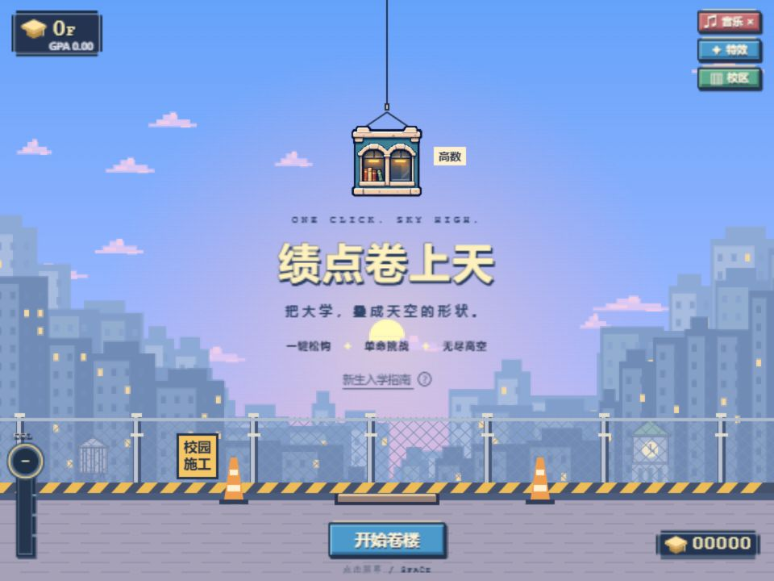
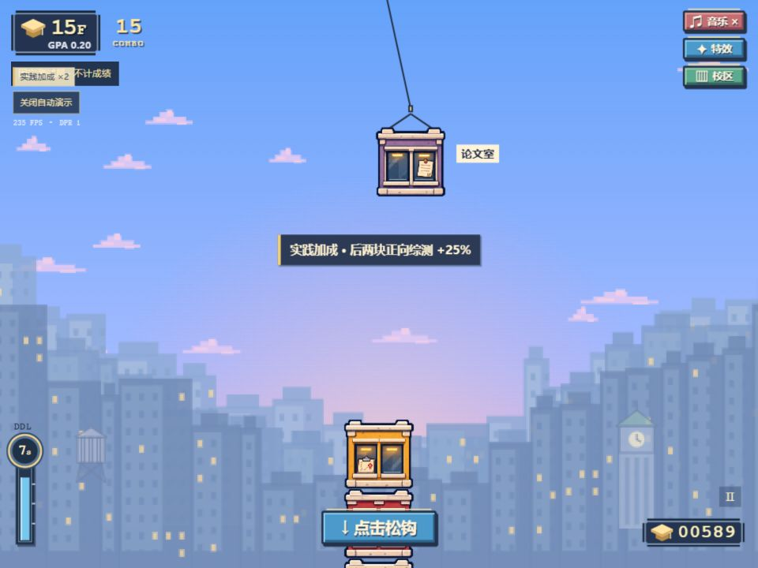

# 绩点卷上天 · Sky-High KPI

像素校园主题的单命无尽堆叠 H5 游戏：一键松钩，在 8 秒 DDL 里，把大学叠成天空的形状。

**[在线试玩（免登录，支持手机）](https://sky-high-kpi-campus-20261125.nevilleatkinson25.chatgpt.site)** · **[下载离线版与部署包](https://github.com/zhangchenxi1224/sky-high-kpi/releases/latest)** · **[实验方案](docs/game-design.md)** · **[验收记录](ACCEPTANCE.md)**



玩法以最终实验方案为准，视觉采用双窗小楼、校园天际线与像素街机 HUD。React 负责界面，Canvas 负责画面，TypeScript 状态机负责规则；无后端、无账号系统。

## 开始玩

- 直接玩：[公开试玩链接](https://sky-high-kpi-campus-20261125.nevilleatkinson25.chatgpt.site)，无需 ChatGPT 登录。
- 离线玩：从 [Releases](https://github.com/zhangchenxi1224/sky-high-kpi/releases/latest) 下载交付包，解压后打开 `绩点卷上天-离线版.html`；Windows 也可运行 `启动游戏.cmd`。
- 本地开发：使用 Node.js 22 或更新版本，执行以下命令。

```bash
git clone https://github.com/zhangchenxi1224/sky-high-kpi.git
cd sky-high-kpi
npm ci
npm run dev
```

开发地址默认 `http://localhost:5178/`。

| 命令 | 用途 |
| --- | --- |
| `npm test` | 运行 26 项规则与状态机测试 |
| `npm run build` | TypeScript 检查并构建静态站到 `dist/` |
| `npm run preview` | 本地预览生产构建 |
| `npm run delivery` | 从已构建的 `dist/` 生成离线 HTML、启动器、静态包和说明 |
| `npm run assets:optimize` | 从保留的原始 PNG 重新生成无损 WebP |
| `npm run licenses` | 更新第三方许可证集合 |

静态发布时上传 `dist/` 或交付包内 `web/` 的全部内容即可。构建产物、依赖和大压缩包不提交到 Git，成品通过 Releases 下载。

- 固定实验局：网址后加 `?mode=fixed&seed=20261125`。页面提供“自动演示全部砖块”，演示与自然局使用同一个引擎，只按真实位置触发松钩，不修改碰撞或奖励，不计入成绩榜。

点击画面 / 松钩按钮 / 空格开始与松钩；S 跳过当前诱惑；Esc 或右下暂停键暂停。校园公告栏包含五维账本、玩法、日落/星空切换、本机成绩榜。切换到其他页面会自动暂停，返回后手动继续。

## 已实现

- READY → SWINGING → DROPPING → RESOLVE → CAMERA_SHIFT → GAME_OVER，单命结束，无毕业强制弹窗。
- 统一 88×88 世界单位砖宽与高度、重力 1400 单位/s²、纯竖直自由下落，位置保留，不裁切、不漂移、不整塔倾覆。
- PERFECT 为 6%，志愿砖 12%；中心偏差 ≤50% 落稳，超出落空。完美仅吸附最多 2 单位，保留真实歪楼。
- 8 秒 DDL、最后 2 秒边缘红光/心跳预警、到期强制提交。
- 随有效层数连续增加的吊车摆速与摆幅、六大类收益、所有 Buff、五款可接受/跳过的诱惑皮肤。
- 实时楼层 / GPA / 综测、连击、收益浮字、金色粒子、落地挤压、合成音乐及音效。
- 操场地基、楼顶天际线、日落、深空渐变；手机竖屏与桌面横屏自适应。
- 本机成绩榜、七套称号、1080×1500 PNG 结业海报（真实塔形、五维雷达图、红章、二维码），可下载或移动端长按保存。
- React + Vite + TypeScript + Canvas + Zustand + Tailwind CSS + ZzFX + qrcode，无后端、无追踪脚本。

## 规则补充与解释

原方案含少量未给出确定公式或单位的字段，本版本采用以下显式口径，均可在 `src/game/rules.ts` 修改：

1. PERFECT 正向收益倍率为 `1 + min(combo,10)×0.1`，上限 ×2；本砖先增加连击，再结算。课业完美增加两级，其他完美增加一级。普通成功清零连击。
2. 竞赛 +5～8 记为竞赛原始积分，再乘总公式中的 15。避免同时沿用旧文档“已折算分”的另一套口径。
3. 实践 +25% 乘接下来两块落稳砖的正向 KPI（不乘楼层10分、不放大负 GPA）。跳过不占实践奖励次数。这样总分始终严格等于五维总公式。
4. 科研 +12% 与竞赛 +15% 仅对下一次挂砖生效；秘籍对接下来三次挂砖生效，跳过也消耗该次挂砖的临时效果。冰美式五秒采用可暂停的模拟时钟。
5. “连续跳过诱惑”只按连续诱惑选择计数；中间正常砖不会打断，接受诱惑会打断。
6. 续命道具池内部采用冰美式35% / 秘籍30% / 诱惑35%。高压且最近四抽没有诱惑时，本抽有30%直接诱惑概率，其余70%按六类基础权重分配，道具类别只抽咖啡或秘籍，避免二次抽到诱惑而超过30%。
7. 方案的摆速公式优先于旁注估算：第35有效层约3.43 rad/s，渐近上限3.8，而非第35层直接设3.8。
8. 纯水平塔身微晃为可选项，本版关闭；塔体始终静止，只有镜头平移。

## 源码导览

| 文件 | 用途 |
| --- | --- |
| `src/game/engine.ts` | 固定120Hz模拟、状态机、DDL、落地提交、Buff 生命周期 |
| `src/game/rules.ts` | 所有公式、判定、权重、砖库与称号条件 |
| `src/game/hook.ts` | 基于 tower_game 固定提交适配的绳端三角几何 |
| `src/view/renderer.ts` | 原图精灵离屏缓存、像素天空、视差天际线、楼塔与反馈 |
| `src/ui/App.tsx` | HUD、设置、结算、键盘/触控、固定测试局 |
| `src/config/memePack.json` | 诱惑皮肤、操作弹幕、称号和评语；修改后重新构建 |
| `src/features/poster.ts` | 离屏高清海报与真实塔形 |
| `src/features/audio.ts` | 手势后初始化 ZzFX，五声音阶反馈和轻量配乐 |
| `art/rooms-original.png` | 用户工作区已有的双窗楼块原始透明精灵 |
| `public/assets/rooms.webp` | 像素内容无损等价编码，减少下载体积 |
| `tests/game.test.ts` | 数值与状态机验收测试 |
| `docs/game-design.md` | 最终实验方案 |
| `docs/screenshots/` | 横屏、竖屏、首屏与海报实测截图 |
| `.github/workflows/ci.yml` | 每次推送和 PR 自动测试、构建并生成下载产物 |

## 运行截图



<p>
  
  
</p>

截图中的固定实验局不计入成绩榜。验收记录包含测试方法与尚未覆盖的真机环境。

## 交付范围

成绩榜仅保存在当前浏览器，无在线跨设备排名。试玩站点已开放公开访问，无需登录；离线版与静态站包可直接交付或自行部署。网页二维码使用当前站点地址，离线版使用项目发布地址。高帧率与微信长按保存仍依赖终端能力；当前设备验证结果见 `ACCEPTANCE.md`，未声称已实测全部手机或微信版本。

`.openai/hosting.json` 是原项目的 Sites 托管绑定，只包含项目标识，不包含密钥。部署到其他平台不需要该文件；不要把其他项目绑定到这个标识。

复用了上游 `iamkun/tower_game` 的绳端几何思路并改写为纯 TypeScript 函数，未把旧引擎、旧三命计分或上游统计脚本一起打包。归属与许可证见 `THIRD_PARTY_NOTICES.md`。本次明确不采用工作目录中旧版接口文档里的滑移、回弹和学年分段规则。

## 素材与许可证

第三方软件的归属与全文许可证分别保留在 `THIRD_PARTY_NOTICES.md`、`public/THIRD_PARTY_LICENSES.txt` 和 `vendor/`。原始双窗精灵保留在 `art/`，不能据第三方软件的 MIT 许可证推断本项目全部美术也按 MIT 授权。本仓库尚未为原创代码及美术另行指定统一开源许可证。
