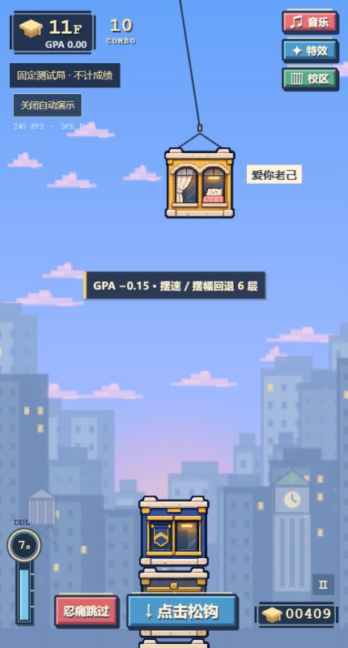
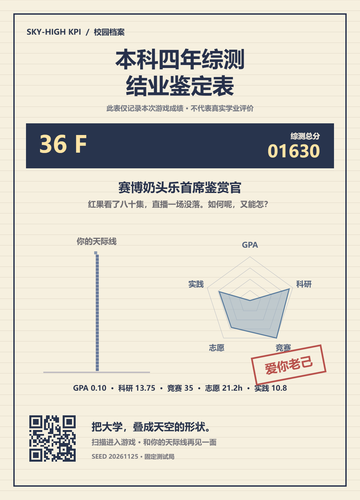

# Don't Collapse, MY GPA!

像素校园主题的单命无尽堆叠 H5 游戏：一键松钩，在 6 秒 DDL 里，把大学叠成天空的形状。

**[在线试玩（免登录，支持手机）](https://sky-high-kpi-merged-20261127.nevilleatkinson25.chatgpt.site)** · **[下载离线版与部署包](https://github.com/zhangchenxi1224/sky-high-kpi/releases/latest)** · **[实验方案](docs/game-design.md)** · **[验收记录](ACCEPTANCE.md)**


玩法以最终实验方案为准，视觉采用双窗小楼、校园天际线与像素街机 HUD。React 负责界面，Canvas 负责画面，TypeScript 状态机负责规则；无后端、无账号系统。

## 开始玩

- 直接玩：[公开试玩链接](https://sky-high-kpi-merged-20261127.nevilleatkinson25.chatgpt.site)，无需 ChatGPT 登录。
- 离线玩：从 [Releases](https://github.com/zhangchenxi1224/sky-high-kpi/releases/latest) 下载交付包，解压后打开 `Dont-Collapse-MY-GPA-Offline.html`；Windows 也可运行 `启动游戏.cmd`。
- 本地开发：使用 Node.js 22 或更新版本，执行以下命令。

```bash
git clone https://github.com/zhangchenxi1224/sky-high-kpi.git
cd sky-high-kpi
npm ci
npm run dev
```

开发地址默认 `http://localhost:5178/`。

| 命令 | 用途 |
| --- | --- |
| `npm test` | 运行 68 项规则、状态机、反馈、转场、音频和成绩卡测试 |
| `npm run build` | TypeScript 检查并构建静态站到 `dist/` |
| `npm run preview` | 本地预览生产构建 |
| `npm run delivery` | 从已构建的 `dist/` 生成离线 HTML、启动器、静态包和说明 |
| `npm run assets:optimize` | 从保留的原始 PNG 重新生成无损 WebP |
| `npm run licenses` | 更新第三方许可证集合 |

静态发布时上传 `dist/` 或交付包内 `web/` 的全部内容即可。构建产物、依赖和大压缩包不提交到 Git，成品通过 Releases 下载。

- 固定实验局：网址后加 `?mode=fixed&seed=20261125`。页面提供“自动演示全部砖块”，演示与自然局使用同一个引擎，只按真实位置触发松钩，不修改碰撞或奖励，不计入成绩榜。

点击首页中央的「开始游戏」开局。局内点击画面、点击松钩按钮或按空格松钩，按 S 跳过当前诱惑。点击右上角「暂停」或按 Esc 可暂停，在暂停菜单里可继续或重新开局。校园公告栏包含五维账本、玩法、日落/星空切换、本机成绩榜。切换到其他页面会自动暂停，返回后手动继续。

## 界面更新（2026-11-28）

- 首页沿用校园背景和小鸟，显示金色英文像素艺术字与开始游戏；删除 BEST 行、旧副标题和功能标签，历史成绩仍可在校区查看。
- 左上角采用深炭黑、米白细边和淡金数字：第一行楼层 / GPA，第二行科研、竞赛、志愿、实践的像素图标与数值，无内部子框。
- Buff / Debuff 在主框下方 6px 独立纵向排列，无状态不渲染；显示咖啡剩余秒数和各类状态剩余次数，暂停时冻结。
- DDL、综测分数和主操作按钮使用统一黑金边框，增益提示作为弹幕横穿天空。
- 黄蓝漫画成绩卡与导出的 PNG 共用真实塔形、雷达图、称号、二维码及小鸟；移除免责声明、SEED 和局模式文字。
- 美术入口：`src/ui/MetricIcon.tsx`、`src/ui/hud.css`、`src/ui/screens.css`、`src/features/report.ts`。状态展示数据：`GameEngine.snapshot().statuses`。

## 像素反馈与音乐（2026-11-28）

- 手机竖屏采用 140×44 两行状态栏；顶部预留金色像素吊臂与吊车净空，设置钮 2×2 排列，Buff 固定在 GPA／五维栏下方 6px 纵排。124px 松钩按钮保留 44px 触摸高度，综测缩小并独立放在右下角；横屏和桌面沿用原布局。
- COMBO 移到右上天空并逆时针倾斜 10°：480ms 四帧爆发后保持 42% 水印，再次 PERFECT 原位累加；普通成功或落空以灰蓝碎片退场。×4 火花、×7 FEVER 与弹幕升级；沿用课业完美 +2、其他完美 +1 的规则。
- 两行 HUD 保留学士帽与四维图标，压缩外框；Buff 在框外纵排，短文本显示百分比和剩余次数，悬停可查看完整说明。砖块标签、收益浮字和控制钮统一像素字体与硬边框。
- 开始按钮触发 800ms 黄色像素溶解；转场期间 DDL 不消耗。关闭特效或开启系统减少动态时使用 160ms 简化转场。
- 用户提供的 MP3 位于 `public/assets/campus-bgm.mp3`，默认开启并尝试自动播放；若浏览器拦截，首次点击页面或开始游戏时播放，以 32% 音量循环。暂停 / 切后台停止，继续时续播；每次打开页面音乐和特效默认开启，手动关闭仅对本次访问有效。音效保持独立控制。
- 首页小鸟默认安静，刷新也不自动弹对话。结算页点击“回首页喂小鸟”才打开对话；关闭结算的 × 按钮只返回安静首页。校区开关仍可主动控制本次访问的小鸟对话。
- 保留摆动相位、难度曲线、镜头和漫画结算卡；吊臂与挂钩恢复上一代的 0.8 倍比例（撤销第二次缩小）并同步悬挂端点，松钩不跳位。保留 20 套称号。
- 开始游戏、点击松钩和 GPA 标签 / 数值使用加粗像素字，保持窄 HUD 布局。
- 全部源码文案通过字体覆盖校验，修复“跳过诱惑”的缺字；以后新增未覆盖字符会使测试失败，避免漏字进入交付包。
- 像素字体使用本地 Fusion Pixel 子集（保持 Ark 基础字形，补全缺字），离线包同时内嵌字体和音乐；更新文字时用 `scripts/build-pixel-font.py` 重新生成字体子集。

## 本次合并（2026-11-27）

来源：GitHub test `b3537c4` + main `7ae745e` + 用户提供的微信试玩包。详细取舍与源码位置见 [合并说明](docs/merge-20261127.md)。

- 保留 test 的平滑概率、收益与细腻塔楼动画，DDL 采用 6 秒。
- 加入体测训练室，固定 4% 抽取；素材完整覆盖 13 款砖块。
- 加入首页小鸟、口粮、喂食与气泡开关，兼容微信版已有的本地存储键。口粮库存最多 8 粒，喂食后可再通过游戏补充；本地日期切换时重置。
- 保留像素弹窗、12 套结算称号和 4 种社交属性。

## 已实现

- READY → SWINGING → DROPPING → RESOLVE → CAMERA_SHIFT → GAME_OVER，单命结束，无毕业强制弹窗。
- 统一 88×88 世界单位砖宽与高度、重力 1400 单位/s²、纯竖直自由下落，位置保留，不裁切、不漂移、不整塔倾覆。
- PERFECT 为 6%，志愿砖 12%；中心偏差 ≤50% 落稳，超出落空。完美仅吸附最多 2 单位，保留真实歪楼。
- 6 秒 DDL、最后 2 秒边缘红光/心跳预警、到期强制提交。
- 随有效层数连续增加的吊车摆速与摆幅、六大类收益、所有 Buff、五款可接受/跳过的诱惑皮肤。
- 实时楼层 / GPA / 综测、连击、收益浮字、金色粒子、落地挤压、循环背景音乐及合成音效。
- 操场地基、楼顶天际线、日落、深空渐变；手机竖屏与桌面横屏自适应。
- 本机成绩榜、二十套称号与四种社交属性、1080×1080 PNG 结业海报（真实塔形、五维雷达图、红章、二维码），可下载或移动端长按保存。
- React + Vite + TypeScript + Canvas + Zustand + Tailwind CSS + ZzFX + qrcode，无后端、无追踪脚本。

## 规则补充与解释

原方案含少量未给出确定公式或单位的字段，本版本采用以下显式口径，均可在 `src/game/rules.ts` 修改：

1. PERFECT 正向收益倍率为 `1 + min(combo,10)×0.1`，上限 ×2；本砖先增加连击，再结算。课业完美增加两级，其他完美增加一级。普通成功清零连击。
2. 竞赛 +4 或 +6 记为竞赛原始积分，再乘总公式中的 15。避免同时沿用旧文档“已折算分”的另一套口径。
3. 实践 +25% 乘接下来两块落稳砖的正向 KPI（不乘楼层10分、不放大负 GPA）。跳过不占实践奖励次数。这样总分始终严格等于五维总公式。
4. 科研 +12% 与竞赛 +15% 仅对下一次挂砖生效；秘籍对接下来三次挂砖生效，跳过也消耗该次挂砖的临时效果。冰美式五秒采用可暂停的模拟时钟。
5. “连续跳过诱惑”只按连续诱惑选择计数；中间正常砖不会打断，接受诱惑会打断。
6. 自然局分九类抽取，同类等概率。[概率表](docs/game-design.md#三自然局无尽抽取节奏极简平滑版)按目标层数平滑过渡。诱惑基础概率在第 8 / 20 / 35 层分别为 1% / 2% / 3%，高压时乘 1.5、最高 4.5%；每次出现后至少间隔 3 块非诱惑砖，GPA 低于 0.30 时不再抽取。第 4 目标层起体测固定 4%，其余七类按原相对比例分摊剩余概率。固定演示的五种诱惑皮肤也分开出场。
7. 摆速从 1.5444 rad/s 逐渐接近 4.2174，最大摆角从 19.08° 逐渐接近 47.7°：相较上一版摆速 +8%、摆幅 +6%，高压触发摆速门槛同步上调 8%，避免额外改变诱惑抽取。诱惑暂缓档位在目标 1～20 / 21～40 / 41+ 层分别为 6 / 4 / 2，不叠加；每落稳一块非诱惑砖恢复一档。有效难度至少为 `1 + 0.65×(目标层−1)`，持续选诱惑也无法锁住低难度。
8. 前两层固定镜头，第 3～6 层拉远，之后约 5¾ 层可见。松钩前，吊砖在最低点距楼顶至少 1.6 块砖高（竖屏）或 2.5 块砖高（横屏）。横屏高层约可见 5½ 层。细腻模式下，楼越高，整座塔的慢摆越明显；搭偏会额外引起回弹和余晃，连续对齐后逐渐回稳。可在校区切回经典模式。

新吊臂与吊钩直接使用用户提供的透明 PNG（`public/assets/crane.png`），金色桁架替代原吊绳并随摆动旋转，顶端连接屏幕边缘。弹幕在 Canvas 的天空之后、吊车与楼体之前绘制，暂停随游戏时钟冻结。

## 源码导览

| 文件 | 用途 |
| --- | --- |
| `src/game/engine.ts` | 固定120Hz模拟、状态机、DDL、落地提交、Buff 生命周期 |
| `src/game/rules.ts` | 所有公式、判定、权重、砖库与称号条件 |
| `src/game/hook.ts` | 基于 tower_game 固定提交适配的绳端三角几何 |
| `src/view/renderer.ts` | 原图精灵离屏缓存、像素天空、视差天际线、楼塔与反馈 |
| `src/ui/App.tsx` | HUD、设置、结算、键盘/触控、固定测试局 |
| `src/config/memePack.json` | 诱惑皮肤、操作弹幕、称号和评语；修改后重新构建 |
| `src/features/poster.ts` | 离屏高清海报与真实塔形 |
| `src/features/bird.ts` / `src/ui/BirdCompanion.tsx` | 小鸟口粮存储、气泡定位、飞行与喂食 |
| `public/assets/fitness.webp` / `public/assets/bird-*.webp` | 微信包原始体测与小鸟素材 |
| `src/features/audio.ts` | 手势后播放本地 MP3，暂停续播与 ZzFX 音效 |
| `art/rooms-original.png` | 用户工作区已有的双窗楼块原始透明精灵 |
| `public/assets/rooms.webp` | 像素内容无损等价编码，减少下载体积 |
| `tests/game.test.ts` | 数值与状态机验收测试 |
| `docs/game-design.md` | 最终实验方案 |
| `docs/screenshots/` | 横屏、竖屏、首屏与海报实测截图 |
| `.github/workflows/ci.yml` | 每次推送和 PR 自动测试、构建并生成下载产物 |

## 运行截图


<p>
  
  
</p>

截图中的固定实验局不计入成绩榜。验收记录包含测试方法与尚未覆盖的真机环境。

## 交付范围

成绩榜仅保存在当前浏览器，无在线跨设备排名。试玩站点已开放公开访问，无需登录；离线版与静态站包可直接交付或自行部署。网页二维码使用当前站点地址，离线版使用项目发布地址。高帧率与微信长按保存仍依赖终端能力；当前设备验证结果见 `ACCEPTANCE.md`，未声称已实测全部手机或微信版本。

`.openai/hosting.json` 是原项目的 Sites 托管绑定，只包含项目标识，不包含密钥。部署到其他平台不需要该文件；不要把其他项目绑定到这个标识。

复用了上游 `iamkun/tower_game` 的绳端几何思路并改写为纯 TypeScript 函数，未把旧引擎、旧三命计分或上游统计脚本一起打包。归属与许可证见 `THIRD_PARTY_NOTICES.md`。本次明确不采用工作目录中旧版接口文档里的滑移、回弹和学年分段规则。

## 素材与许可证

第三方软件的归属与全文许可证分别保留在 `THIRD_PARTY_NOTICES.md`、`public/THIRD_PARTY_LICENSES.txt` 和 `vendor/`。原始双窗精灵保留在 `art/`，不能据第三方软件的 MIT 许可证推断本项目全部美术也按 MIT 授权。本仓库尚未为原创代码及美术另行指定统一开源许可证。

## 结算小鸟与本地记忆（2026-11-28）

- 台词按全收集、解锁并破纪录、新人格、最高分或最高层、接近纪录、手感不好、日常陪伴的顺序判定；首局优先展示人格解锁。
- 人格总数读取 `memePack.titles`，当前为 20，显示真实的 `1/20` 等进度；每条最多 10 字符，单行像素气泡，以描边颜色区分情绪。同一类型避免连续重复台词。
- 累计局数、历史最高分／最高层、已解锁称号 ID 和上次台词保存在 `sky-high-kpi-v1` 的 `state.playerStats`。旧版仅保存前十成绩，升级时从现有记录恢复可确认的数据，不虚构未保存的历史局数。
- 每个正常局只结算一次，先比对旧数据再保存；固定演示不写入个人统计。结算图与 PNG 使用同一条已确定的台词，重新生成图片不会重抽或重复解锁。
- 逻辑：`src/features/bird-ending.ts`；短句：`src/config/memePack.json` 的 `birdEndingLines`；像素气泡：`src/features/report.ts`，像素字体在导出前嵌成图片避免漏字。

## 开局课业连出保护（2026-11-28）

前 3 块原始课业权重为 60%，独立抽取可能连续出现课业。当前自然模式在前 8 个目标层加入保护：已连续抽到两块课业砖时，下一块暂时排除课业，权重按比例分配给其他正向类别；诱惑的已选概率与体测绝对 4% 不变。第 9 层起恢复原有概率表，不额外减少后期 GPA 来源。固定演示序列不受影响。配置入口为 `src/game/rules.ts` 的 `OPENING_DRAW_RULES`。

## 配比实验方案

[砖块配比与六种诱惑效果实验方案 B](docs/balance-experiment-20261128.md) 包含当前问题、候选概率表、每组 50,000 条出砖序列模拟、增益 / 减益 / 操作判定型诱惑设计和真人验证标准。当前正式玩法尚未采用候选配比及新诱惑效果；本次正式修改是恢复上一代吊车尺寸。
